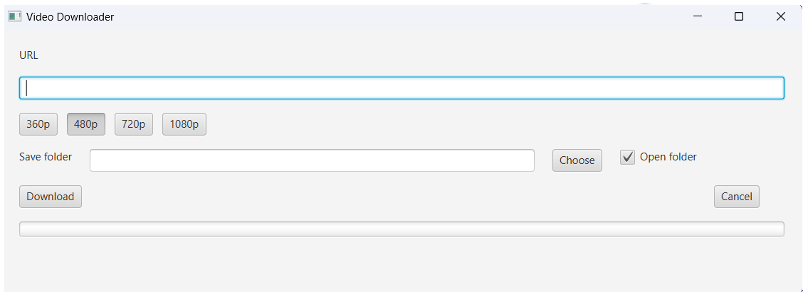

# Video Downloader

A simple desktop application for downloading videos and playlists.

The application was originally created for downloading videos from YouTube, but it can also work with many other video hosting platforms supported by [yt-dlp](https://github.com/yt-dlp/yt-dlp).

## Screenshot

## Technologies

* Java 21
* JavaFX 21
* Maven
* yt-dlp
* FFmpeg

## External Tools

The application uses the following external tools:

* `yt-dlp.exe` — video extraction and downloading
* `ffmpeg.exe` — media processing and merging
* `ffprobe.exe` — media information

They are stored in the `tools` directory next to the application.

If downloading stops working, these files can be replaced with newer versions without rebuilding the application.

## Supported Platforms

The application is currently intended for Windows.